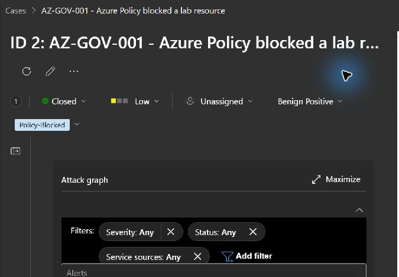

# Azure Cloud Security Lab

I built an isolated Azure lab to follow a security event from prevention to investigation. Azure Policy blocked two intentionally misconfigured deployments. Microsoft Sentinel turned a policy denial into an incident, applied a triage label, and gave me the evidence to confirm that the blocked resource was never created.

```text
Azure Policy blocks a test deployment
    → Azure Activity Log records the denial
    → Log Analytics makes the event searchable
    → Sentinel opens and labels an incident
    → Analyst verifies the outcome and closes the case
```



## What I verified live

| Scenario | Outcome | Evidence |
|---|---|---|
| Policy enforcement | Azure blocked an untagged network security group and a storage account configured to allow anonymous blob access. One denial produced a Sentinel incident, which was labeled and closed. | [Policy tests](evidence/GOV-DENY-001-policy-enforcement.md) · [Investigation](investigations/AZ-GOV-001-investigation.md) |
| Diagnostic settings change | A controlled configuration change generated a Medium Sentinel incident. Automation added the triage label, and I closed the incident after verifying the change. | [Evidence](evidence/AZ-CP-001-detection-incident.md) · [Investigation](investigations/AZ-CP-001-investigation.md) |
| Temporary access change | Azure logged a Reader assignment to an empty test group. A KQL query found the event, and the assignment and group were removed. The scheduled rule is included as source. Its incident workflow was outside the verified result. | [Evidence](evidence/AZ-IAM-001-rbac-change.md) · [Investigation](investigations/AZ-IAM-001-investigation.md) |

The lab also included a [secure resource baseline](evidence/GOV-BASE-001-secure-baseline.md) and a [workbook](evidence/AZ-WB-001-workbook.md) for reviewing changes. See the [evidence index](evidence/README.md) and [screenshot index](screenshots/README.md) for supporting records.

## Reproduce the lab

Start with the [safe reproduction guide](docs/reproduction-guide.md) and [architecture](docs/architecture.md). The repository includes [Bicep templates](infrastructure/), [policy controls](governance/), [KQL queries](hunting-queries/), [Sentinel rules](analytics-rules/), and [triage automation](automation/). Analytics and automation rules default to disabled.

Run `pwsh -File scripts/Test-Repository.ps1` with the Bicep CLI on your path to validate the source locally. This check does not create Azure resources. Review the [known limitations](docs/known-limitations.md) and [cost controls](docs/cost-control.md) before using your own isolated subscription.

## Lab status

Live validation took place on 4–5 November 2026. I closed the test incidents, disabled the rules, removed the temporary access, and canceled the lab subscription on 5 November. This repository is a record of the lab and a starting point for reproducing it. [Cleanup verification](docs/cleanup-verification-report.md)
