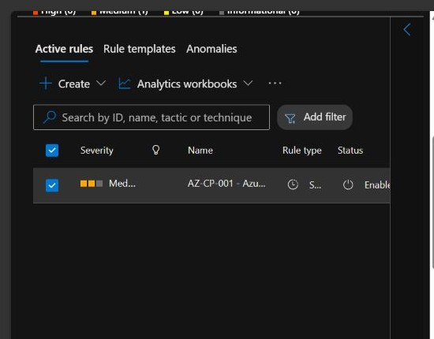

# AZ-CP-001 — Azure Diagnostic Settings Changed or Deleted

## Goal

Detect a successful control-plane operation that creates, changes, or deletes an Azure
Monitor diagnostic setting. An unexpected change can interrupt security telemetry and
reduce a SOC's visibility.

## Data and logic

- Table: `AzureActivity`
- Operations: `Microsoft.Insights/diagnosticSettings/write` and
  `Microsoft.Insights/diagnosticSettings/delete`
- Result filter: successful operations only
- Scheduled-rule window: 1 hour during the initial connector-latency test
- Scheduled-rule frequency: 5 minutes
- Threshold: at least one result
- Severity: Medium
- Incident creation: enabled when the rule is enabled

The source template keeps the rule disabled until the query is validated against the
live workspace. This prevents unverified content from silently becoming an active
security control.

Local Bicep compilation and an Azure Resource Manager what-if both succeeded on
4 November 2026. What-if reported one planned alert-rule creation with `enabled=false`;
it did not deploy the rule.

The rule was subsequently deployed disabled, then enabled only after the live
`AzureActivity` pipeline produced its first successful control-plane event. The initial
test uses a one-hour lookback to accommodate first-time export latency.

## ATT&CK hypothesis

- Tactic: Defense Evasion
- Technique: T1562 — Impair Defenses

The mapping applies when the change is intended to weaken or disable telemetry. A
legitimate administrator redeployment is benign and must be documented as such.

## Test plan

1. Confirm the baseline diagnostic setting and its enabled categories.
2. Redeploy the same approved configuration; do not delete or disable logging.
3. Confirm the write event in the Azure Activity Log.
4. Validate the hunting query against `AzureActivity`.
5. Deploy the scheduled rule disabled and inspect its configuration.
6. Enable it briefly, repeat the safe redeployment, and verify one alert/incident.
7. Investigate and close the incident as benign positive activity.
8. Disable or remove the rule after evidence capture unless continuing the lab.

## Privacy

Public evidence must not expose caller email, caller IP, subscription ID, tenant ID,
workspace ID, resource ID, or correlation ID. Those fields can be used privately during
investigation and summarized generically in the public report.
