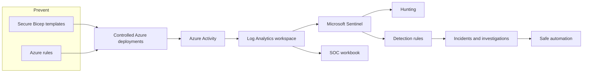

# Architecture and Trust Boundaries

## Implemented design

## Resource boundary

- One dedicated monitoring resource group owns the workspace and Sentinel resources.
- A dedicated security resource group held the baseline and policy tests.
- Azure Activity export is subscription scoped but sends only to the dedicated lab
  workspace.
- Entra telemetry was deliberately excluded because it was not required to prove the
  Azure control-plane detection workflow.
- No production, personal-file, email, endpoint, or unrelated Azure data source is
  connected.

## Network boundary

- The architecture requires no virtual machines, public IP addresses, RDP, SSH, or
  public application endpoint.
- Azure management-plane APIs generate the primary telemetry.
- The storage and Key Vault resources contain no personal data and use
  deny-by-default data access rules.

## Identity boundary

- The owner account is used only for initial subscription and platform administration.
- Fictional test identities are used when Entra scenarios are available.
- No privileged role-change scenario is executed without a separate least-privilege
  review and explicit approval.
- Credentials, tenant IDs, subscription IDs, object IDs, and full IP addresses stay
  outside the repository.

## Evidence boundary

Source telemetry, query results, analytics-rule execution, live incidents, and
automated response are distinct evidence states. Raw Azure exports remain private;
only sanitized evidence enters Git.
