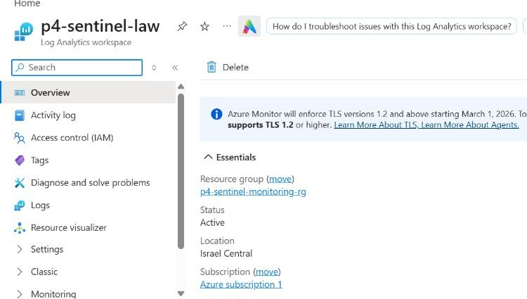
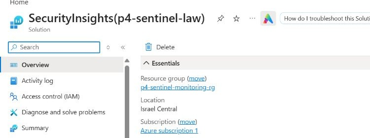

# AZ-BASE-001 — Sentinel Foundation Deployment

## Objective

Deploy a minimal-cost Microsoft Sentinel foundation into a dedicated Azure resource
group using version-controlled Bicep, then verify the resulting control plane state.

## Result

Verified live on 4 November 2026.

- Deployment `p4-sentinel-deploy-20261104-r2` completed successfully.
- Log Analytics workspace `p4-sentinel-law` reports provisioning state `Succeeded`.
- The workspace is active in Israel Central with 30-day retention.
- Microsoft Sentinel's `default` onboarding state exists on the workspace.
- Local authentication is disabled and resource-only log access is enabled.
- The resource group carries project, environment, and expiry tags.
- No virtual machine, public IP, Defender paid plan, or premium Entra license was added.

## Evidence





The screenshot intentionally excludes the account banner and all Azure identifier
fields. The complete raw capture is retained locally in the ignored private evidence
directory and is not part of Git history.

## Reproduction

```powershell
az deployment sub create `
  --name p4-sentinel-deploy-20261104-r2 `
  --location israelcentral `
  --template-file infrastructure/main.bicep
```

Use a local parameter file for any environment-specific values. Never commit tenant,
subscription, or workspace identifiers.
