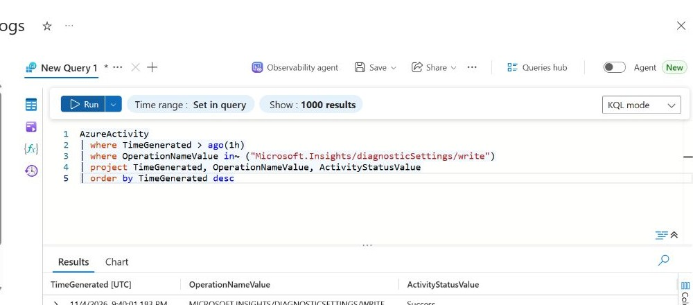

# AZ-CP-001 — Detection, Incident, and Investigation Evidence

## Acceptance results

| Stage | Result |
|---|---|
| Source event in Azure Activity Log | Verified |
| Event in `AzureActivity` | Verified |
| Hunting query | Verified |
| Scheduled analytics rule | Verified |
| Alert generated | Verified, one alert |
| Incident generated | Verified, Medium severity |
| Scoped SOAR automation | Verified, Active/Medium plus `SOAR-Triaged` |
| Analyst investigation | Completed |
| Closure | Benign positive / suspicious but expected |
| Post-test state | Analytics and automation rules disabled |

## Live KQL evidence

The visible query projects only time, operation name, and status. Identity, IP,
subscription, tenant, resource, authorization, and correlation fields are excluded.

## Incident evidence

The Sentinel incident API returned the expected title with one alert, Medium severity,
Active status, and `SOAR-Triaged` after automation. The final update returned Closed,
`BenignPositive`, `SuspiciousButExpected`, Medium, and the preserved label. No incident
or alert identifier is committed.

See the full sanitized analyst report in
[`investigations/AZ-CP-001-investigation.md`](../investigations/AZ-CP-001-investigation.md).
