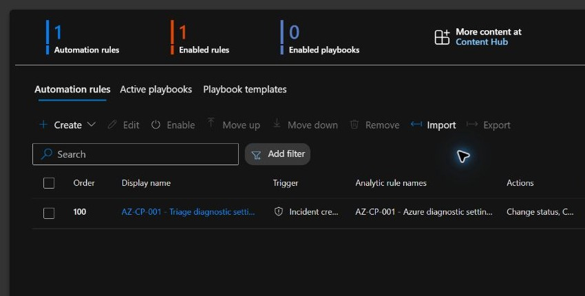

# AZ-SOAR-001 — Scoped Incident Triage Automation

## Objective

Automatically triage only incidents created by AZ-CP-001 without deploying a billable
Logic App or performing a destructive response.

## Deployment result

Verified live on 4 November 2026.

- Automation rule: `AZ-CP-001 - Triage diagnostic settings incidents`
- Trigger: incident created
- Condition: related analytics rule contains AZ-CP-001
- Actions: set status Active, set severity Medium, add `SOAR-Triaged`
- State: enabled
- Playbooks: none

## Execution result

Verified live. The AZ-CP-001 incident was created with one alert and returned from the
Sentinel API as Active, Medium, and labeled `SOAR-Triaged`. The label was preserved when
the analyst later closed the incident. The automation rule was disabled after the test
to prevent duplicate processing.
