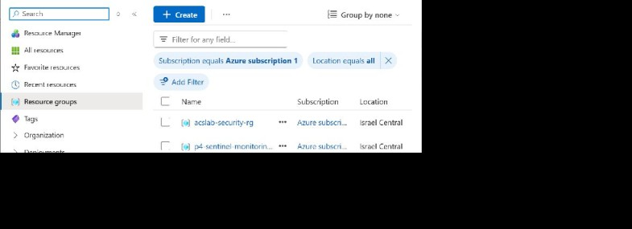

# GOV-BASE-001 — Secure Azure Baseline

## Result

Verified live on 5 November 2026 in Israel Central.

- One dedicated security resource group.
- One empty Standard LRS storage account with HTTPS only, TLS 1.2, anonymous blob
  access disabled, and a default-deny network rule.
- One empty Key Vault using Azure role-based access, soft delete, and a default-deny
  network rule.
- One network security group with no inbound rules.
- Shared project, environment, expiry, and synthetic-data tags.
- No virtual machine, public IP address, secret, key, certificate, or stored object.

## Deployment correction

The first Key Vault request failed because Azure no longer accepts explicitly setting
purge protection to `false`. The template was corrected by omitting that unsupported
field and the second deployment succeeded. The failed request created no vault.
