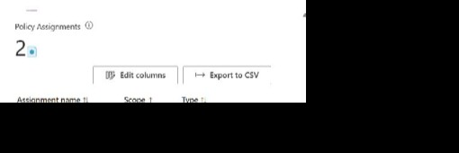

# GOV-DENY-001 — Policy Enforcement

## Result

Two narrow deny policies are enforced only within the dedicated security lab resource
group:

1. Require a `project` tag on taggable resources.
2. Block storage accounts that allow anonymous blob access.

## Controlled tests

| Test | Expected | Observed | Residual resource |
|---|---|---|---|
| Empty network security group without project tag | Blocked | `RequestDisallowedByPolicy` | None |
| Tagged storage account with anonymous blob access enabled | Blocked | `RequestDisallowedByPolicy` | None |

The first tag test was deliberately attempted during policy propagation and initially
succeeded. The empty test resource was detected and removed immediately. After
propagation, the repeated test was blocked. This timing behavior is retained as a real
implementation lesson rather than hidden from the evidence.

The two original deny events later appeared in `AzureActivity` as Policy-category
`MICROSOFT.AUTHORIZATION/POLICIES/DENY/ACTION` records with `Failure` status. A fresh
blocked tag test was generated at 04:33:46 UTC on 5 November 2026 for scheduled-rule
validation.

That fresh event produced one Sentinel alert and incident. The scoped automation added
`Policy-Blocked`; the analyst closed it as benign positive / suspicious but expected.
See [`AZ-GOV-001-detection-incident.md`](AZ-GOV-001-detection-incident.md).

## Safety

The tests created no public endpoint, compute service, data, secret, or inbound network
rule. The blocked resource names and Azure identifiers are excluded from public
evidence.
